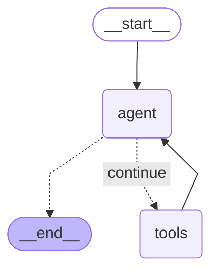

# @glyphcss/diagrams

2D Mermaid flowcharts, class and ER diagrams, state, block, architecture, requirement and C4 diagrams, git histories, mindmaps and JSON graphs rendered into text cells for chat, terminals, and HTML. Layout and rendering are asynchronous. The pipeline uses the public glyphcss cell canvas, with no camera, scene, or DOM renderer.

> Layout and the examples below use the installed `@dagrejs/dagre@3.1.1`. `fixtures/langgraph-export.mmd` is the real, unmodified `draw_mermaid()` export byte-for-byte (including its `&nbsp;`-padded conditional edge text); `fixtures/langgraph.mmd` is a variant that makes agent→tools solid and keeps a labelled dotted edge to `__end__`.

```ts
import { renderGlyphDiagram } from "@glyphcss/diagrams";

const diagram = await renderGlyphDiagram(`flowchart LR
  request[Request] --> agent[Agent] --> answer[Answer]
`, { target: "chat", charset: "box", width: 80, height: 20 });
console.log(diagram.text);
console.log(diagram.report.ledger);
```

`renderGlyphDiagram` accepts Mermaid source or a `GlyphGraph`. `glyphGraphFromJson` accepts an object with `nodes` and `edges`, defaulting `direction` to `TB`. `renderGlyphDiagramJson` accepts JSON text and returns a Promise of JSON text: `{ text, html?, meta, report }` on success or `{ error, code, hint }` on failure.

React and Vue can call the diagram renderer from their own effect/mount hooks and display the result in a monospace `<pre>`. These 2D outputs do not need the scene components from `@glyphcss/react` or `@glyphcss/vue`. The website's `/diagrams` export window generates HTML, TypeScript, React, and Vue examples for Graph, Sequence, and Lanes; its framework examples ignore asynchronous results after unmounting and encode cell colors as browser HTML.

```ts
import { glyphGraphFromJson, renderGlyphDiagramJson } from "@glyphcss/diagrams";

const graph = glyphGraphFromJson({
  nodes: [{ id: "start", label: "Start" }, { id: "work", label: "Work", shape: "rounded" }],
  edges: [{ id: "run", from: "start", to: "work", label: "run", priority: 2 }],
  direction: "LR",
});
const encoded = await renderGlyphDiagramJson(JSON.stringify(graph), { target: "terminal" });
```

## Graph and source vocabulary

- Nodes: `{ id, label, kind?, group?, shape?, compartments? }`. Shapes: `rect`, `rounded`, `diamond`, `circle`, `subroutine`, `asymmetric`, `stadium`, `cylinder`; all reserve rectangular footprints, with cell-sized border distinctions. `point` is the exception: no border, just the first character of its `label` (a start or end marker; a longer label is cut and `label-abbreviated` says so, an empty one is `bad-node`). One edge entering it ends in one arrowhead against the glyph; several meet in a bar and reach the glyph through one arrowhead; several leaving it join the glyph through a bar. A point cannot hold a self edge (`point-loop`).
- `compartment` nodes reuse the rectangle outline: `label` is the centered header; `compartments: string[][]` holds left-aligned member rows, with a horizontal rule before each populated compartment. Empty or omitted compartments add no rows; a single-line header without members is a plain three-row rectangle. Rules and wrapped members participate in measurement, port reservation, fitting and paging. Side ports avoid separator rows and corners in every layout. The field is valid only with `shape: "compartment"`.
- Edges: `{ id?, from, to, label?, style?, priority?, startHead?, endHead?, invisible? }`. Styles: `solid`, `dotted`, `thick`, `undirected`. Larger priority routes first and wins an unavoidable crossing. Heads are `arrow`, `circle`, `cross`, `none`, `triangle`, `filled-diamond`, `open-diamond`, `er-one`, `er-zero-one`, `er-many`, or `er-zero-many`; the default is no start head and an arrow end (no end for `undirected`). `invisible: true` participates in layout and paints nothing.
- Groups: `{ id, label?, members: string[], parent? }[]`. Nested/disjoint membership uses compound dagre layout; a group's parent is the smallest group holding all its members, unless it names `parent` (needed only when both list the same nodes). A frame is padded outside the frames it holds; a graph that only fits without that padding gets shared borders before its words are cut or it is split. Overlapping memberships use explicit member-list annotations when an enclosure would claim unrelated nodes.
- Directions: `TB`, `LR`, `BT`, `RL`; Mermaid `TD` normalizes to `TB`.
- Mermaid: `flowchart`/`graph`, `[ ]`, `( )`, `{ }`, `(( ))`, `[[ ]]`, `>( ]`, `([ ])`; `-->`, `---`, `-.->`, `==>`, `-- text -->`, `-->|text|`, `-. text .->`, chained edges, `&` fan-out, and `subgraph ... end`.
- `classDef`, `class`, `style`, `click`, `linkStyle`, and `%%` comments remain inert source directives, parsed as data and never executed. URLs/callbacks are never followed. LangGraph paragraph wrappers (`<p>…</p>`) are stripped and numeric and HTML named entities (`&#NN;`, `&#xHH;`, `&copy;`, Mermaid `#copy;`) are decoded once in labels; `&nbsp;` becomes a plain space, trimmed at label ends. A quoted label, a `|label|` edge label, and a `-. text .->` edge-text span are all protected from statement-splitting, so an entity's own `;` can't truncate a statement early.
- A self-edge (`A --> A`) draws as a compact four-cell loop on the side no flow edge uses (right of a `TB`/`BT` node, below an `LR`/`RL` one): out of one port, around, and back into the next with an arrowhead. Its label sits one blank cell past the loop (the one label that does not touch its route) and wraps like a node label, at `loopLabelWidth` cells (default 24), which the fitter narrows before it gives up whole words. Layout reserves exactly the loop's and label's room, and a group frame encloses them, so they never touch another node, edge, label or frame. Several loops on one node stack without touching, and a left-to-right graph that wraps into rows keeps its loops.
- Other diagram kinds reject by name, e.g. `GLYPH_MERMAID_UNSUPPORTED_SEQUENCEDIAGRAM`, `GLYPH_MERMAID_UNSUPPORTED_GANTT`. `sequenceDiagram` has its own `./sequence` entry; `stateDiagram` is below.

Additional flowchart syntax follows the [official Mermaid flowchart reference](https://mermaid.js.org/syntax/flowchart.html). Shapes reuse the approved border families; no new outlines are introduced.

| Construct | Behaviour |
|---|---|
| `A@{ shape: name, label: "text" }` | All documented v11 shape names and aliases map to the closest existing family; labels and later property updates are preserved |
| `A@{ icon: "fa:user", form: "circle", label: "User" }`, `A@{ img: "url", label: "Photo", w: 60, h: 60, pos: "t", constraint: "on" }` | Label in an approved family (icon form respected); no icon lookup, image fetch, sizing or execution |
| `A[(text)]`, `A(((text)))` | Cylinder, circle (second ring omitted) |
| `A[/text/]`, `A[\text\]`, `A[/text\]`, `A[\text/]`, `A{{text}}` | Rectangle; clean inner label |
| `A{text}`, `A@{shape: diam, label: "text"}` | Rounded approved diamond family with `◆ text` (`* text` in ASCII), with one blank cell inside each border; the presentation marker yields to fitting (below); graph labels stay `text` |
| `A <--> B`, `A <-.-> B`, `A <==> B` | One solid/dotted/thick edge with a head at each border; one label |
| `A --o B`, `A --x B`, `A o--o B`, `A x--x B` | Circle/cross border heads (`●`/`✕`; ASCII `o`/`x`) |
| Longer solid/dotted/thick/open links, including labelled variants | Accepted with compact renderer spacing; length preference logged |
| `A ~~~ B` | Layout-only connection; no route, label or head is painted |
| `A e1@--> B`, `e1@{ animate: true, animation: fast, curve: basis }` | Properties attach only to ids declared on parsed links (before/after declaration); quoted label text cannot become metadata; animation logged, routes stay orthogonal |
| `A --> B & C --> D`, `A & B --> C & D` | Chaining and Cartesian fan-in/fan-out; equally sized siblings with identical neighbours/style keep authored order when crossing-free |
| Markdown strings (``"`**bold** and *italic*`"``) | Plain text with authored line breaks and renderer wrapping; formatting omitted |
| `:::class`, styling, click directives, comments | Inert; Unicode ids/labels and Mermaid decimal and HTML named entities (`#35;`, `#copy;`, `&copy;`) decoded once |
| Local `direction` in a subgraph | Inherits diagram direction; logged |
| Edges to/from subgraph ids | Attach to first/last real member; logged; empty subgraphs become labelled rectangles |
| YAML frontmatter, `accTitle`, `accDescr` | Inert metadata; logged |

Approximations use `mermaid-degraded` with `detail.kind`; shape notes are deduplicated by canonical shape kind (including aliases). Unknown future shapes fall back to rectangles. Malformed syntax still uses `GLYPH_MERMAID_SYNTAX`. The checked-in `fixtures/flowchart-v11.json` supplies executable examples for every shape alias and edge family.

## Mermaid block, architecture, requirement and C4 diagrams

These adapters use the graph pipeline and approved node outlines. The executable
catalogue is `fixtures/mermaid-task5.json`; each example is checked at 72 columns
for chat (`box`, 24 rows) and web (`braille`, 32 rows).

| Source | Supported syntax | Cell rendering and logged approximations |
|---|---|---|
| `block`, `block-beta` | `columns N` / `auto`, `id:width`, `space[:width]`, named/anonymous nested `block ... end`, flowchart shapes, labelled/dotted/thick/open/bidirectional links, `<["label"]>(right/left/up/down/x/y/combined)` arrows | Equal-width columns use the widest single-column need (or a spanning block's per-column need); span N covers N columns and N−1 gaps. Each nested grid uses its own column count and row wrapping within its allocated span. Frames keep one blank row/cell between their borders and content, including nested frames. Labels wrap at whole words before overwide rows use fewer columns (`block-row-wrap`); spans clamp to that row. Nested blocks use group frames. Block arrows use the asymmetric family plus direction tags. Crowded routes/captions, overheight fixed grids, self-loops or grids above 256 columns yield to the graph fitter (`block-layout`); `overflow: "expand"` keeps the grid and grows height. |
| `architecture`, `architecture-beta` | Groups, nested `in`, services, junctions, built-in/custom icon names, all `L/R/T/B` ports, `--` / `<--` / `-->` / `<-->`, `{group}` edges, `align row/column` | Icons become inert text tags (`database` → `[db]`); junctions use `+` points. The first source port guides overall direction; routing chooses actual ports, logged. Group edges connect the named member through its frame; alignment constraints yield to layout, logged. A junction self-loop uses a rounded box. |
| `requirementDiagram` | All six requirement types, `id/text/risk/verifymethod`, elements with `type/docref`, all seven labelled relationships in either written direction, quoted/plain text, markdown, `direction`, classes/styles | Existing compartment rectangles keep type stereotypes and left-aligned fields. Relationships use labelled solid (`contains`) or dotted directed edges. Markdown becomes plain text; styles stay inert. |
| `C4Context`, `C4Container`, `C4Component`, `C4Dynamic`, `C4Deployment` | Person/System/Container/Component, external/Db/Queue variants, boundaries, deployment nodes and Node aliases, Rel/BiRel, directional/backward relations, RelIndex, positional and `$named` arguments | Person → rounded plus stereotype; Db → cylinder; Queue → rectangle plus stereotype; external → text marker because approved borders are solid. Nested boundaries use groups. Labels, technology and descriptions survive; dynamic numbering follows relation order. Direction hints yield to graph layout. C4 defaults to adaptive orientation to keep group-edge captions; explicit `direction` / `autoDirection` options override it. |

Styles, configuration (`UpdateLayoutConfig` included), callbacks, URLs and assets
stay inert and are never fetched or executed. C4 source titles are inert; pass
`title` to the renderer. Empty groups become labelled rectangles. Group-id edges
attach to their first/last real member. Approximations appear as
`mermaid-degraded` entries with `detail.kind`; normal fit losses retain the
existing ledger codes. Malformed statements have named
`GLYPH_MERMAID_{BLOCK,ARCHITECTURE,REQUIREMENT,C4}_SYNTAX` errors (shared flowchart
shape/link errors use `GLYPH_MERMAID_SYNTAX`). CJK still folds to `?` on the shared
canvas, with `label-folded` notes.

Empty and space-only blocks (for example `block\nspace:3`) render a blank canvas
(or only the render-option title), with a `block-empty` ledger note and no fake node.
This exception follows the in-memory block hint; empty JSON graphs still reject
with `empty-nodes`.

Block placement and C4 adaptive orientation are internal source hints preserved
by `glyphGraphFromMermaid` and object rendering. JSON serialization keeps graph
semantics but omits these symbol hints, so a JSON round trip uses ordinary graph
layout. Exact icon artwork, arrow polygons, SysML/C4 styling and force-directed
architecture alignment are intentionally approximated, not new visual families.

## Mermaid state diagrams

`renderGlyphDiagram` and `glyphGraphFromMermaid` accept `stateDiagram` and `stateDiagram-v2` and render them through the graph pipeline (fit, route, paint like a flowchart); `glyphGraphFromMermaidState` is the same adapter on its own. States are nodes, transitions are labelled edges, and the default direction is `TB`.

Supported:

- `A --> B` and `A --> B : event`; a state is declared by use. `state "Long name" as Id` sets its title; each `Id : text` line adds a row under the title, so a state reads `title` then one row per description. States are `rounded` boxes.
- `[*]` as a start (`[*] --> X`) or an end (`X --> [*]`). Every scope (the diagram, and each composite) has one start and one end node shared by all its `[*]` uses, drawn as a borderless `point` whose label is `●` (start) or `◉` (end); in `ascii` the glyphs fold to `*` (`●`, `◆`) and `@` (`◉`) in any label, reported as `label-folded` like other folds. An edge enters a point through an arrowhead on the row above its glyph (the column before it, left to right), and several exits join the glyph through a bar. Their node ids are `[*]:start`, `[*]:end`, and `[*]:start:<composite>`, `[*]:end:<composite>`, and their `kind` is `state-start` / `state-end`.
- `state Parent { ... }`, nested: a group around its inner states and its own start/end. A state belongs to the scope where it is first mentioned. The graph connects nodes, not groups, so `X --> Parent` ends at the composite's inner start (else its first inner state) and `Parent --> X` leaves from its inner end (else its last inner state). A composite with no inner state is an ordinary state.
- `state c <<choice>>` (or `[[choice]]`, or `state "Decide" as c <<choice>>`): a `diamond` whose label is `◆` (`*` in `ascii`).
- A composite is labelled with its `state "Name" as P` name, then any `P : text` lines after ` - `. A state id used inside a second composite is the same state (ids are global, as in Mermaid) and the ledger says so with `state-shared`.
- `direction LR|TB|RL|BT|TD`. Inside a composite it is ignored. `%%` comments (a whole line, trailing, or a multi-line `%%{ init ... }%%` before the header), `classDef`, `class`, `style`, `hide empty description`, `scale N [width|height]` and `:::name` are inert data. Statements end at a newline or `;` (not inside a quoted name, an HTML entity, or after a transition's `:`, where the rest of the line is its label); a composite's `}` stands on its own line. `state` and `end` are keywords, not state names.
- A self transition `A --> A : retry` draws as the loop above.
- After a transition's ` : ` or a description's, a quote is an ordinary character (`A --> B : 5" pipe`) and a newline always ends the statement; a quote opens a name only after `state`.

Rejected by name, never silently dropped (each code has a repair hint in `glyphDiagramRepairHint`):

| Code | Construct |
| --- | --- |
| `GLYPH_MERMAID_STATE_NOTE` | `note ... of X`, `note ... end note`, `floating note` |
| `GLYPH_MERMAID_STATE_CONCURRENCY` | `--` concurrent regions |
| `GLYPH_MERMAID_STATE_COMPOSITE_LOOP` | a composite state transitioning to itself (`P --> P`): a loop hangs on a node's border, and a frame is only drawn after layout; put it on an inner state |
| `GLYPH_MERMAID_STATE_FORK_JOIN` | `<<fork>>` and `<<join>>`: the bar is one cell thick, but a node box is at least three rows tall and its border takes the arrowhead |

Anything else that is not a state statement is `GLYPH_MERMAID_SYNTAX`.


## Mermaid gitGraph and mindmap

The existing `renderGlyphDiagram(source, options)` and `glyphGraphFromMermaid(source)` entries dispatch both headers. Examples for every feature family are executable in `fixtures/mermaid-task3.json`.

**gitGraph** reuses `./lanes`, with one `*` per commit and its id, tags and annotations beside it. It accepts `commit` (`id`, `type: NORMAL|REVERSE|HIGHLIGHT`, `tag`), quoted/unquoted `branch` names with `order`, `checkout`/`switch`, `merge` with the same commit attributes, and `cherry-pick id: "source" [parent: "merge-parent"]`. Cherry-picks have one ancestry parent (the current head); source and selected merge parent are text annotations. Generated ids are deterministic and avoid authored ids. Branch names annotate their final heads; marker, header and tag-outline approximations are logged as `git-layout`.

- `TB:` reads oldest first down the page; `BT:` reads newest first. Default/explicit `LR:` degrades to oldest-first vertical lanes, leaving room for labels at 72 columns (`git-orientation`). Branch identity keeps main in the first lane by default. Unordered branches follow declaration order, then explicitly ordered branches follow numeric `order`; `mainBranchOrder` can reposition main. Width pressure can collapse lanes with `lane-cap-collapsed`.
- Init directives and YAML frontmatter are never executed. YAML comments are stripped without changing quoted hashes. Only scalar `mainBranchName`, `mainBranchOrder`, `showBranches`, and `showCommitLabel` are read as source data. Hiding branches hides names; ancestry lines remain (`git-hidden-branches`). Hiding labels hides ids, retaining tags/types/provenance. Themes, rotation, parallel placement and other configuration are inert (`git-config`).
- `REVERSE`/`HIGHLIGHT` become text (`git-types`); merge circles become the existing marker plus connectors and `merge`/type text (`git-merge`); cherries become provenance text (`git-cherry-pick`). No new glyph families.
- Root results retain ancestry in `meta.nodes`/`meta.edges`; graph-only `layout.nodes/edges/ports`, `routes`, and `labels` are empty because lanes own placement. `glyphGraphFromMermaid` returns a conventional rounded-node ancestry projection; rendering that graph uses the graph pipeline. Source rendering uses lanes. Graph-only spacing/direction/color callbacks do not configure lanes; native `./lanes` remains available for lane options.
- Invalid statements/references use `GLYPH_MERMAID_GIT_SYNTAX`; duplicate branch/commit ids and cherry-picks without a required immediate merge parent reject.

**mindmap** uses indentation (including uneven dedents) to build a left-to-right tree with undirected connectors. This keeps words horizontal and leaves wrapping/paging to the graph fitter, rather than spreading a radial map across 72 columns. Siblings retain authored top-to-bottom order. Apostrophes are ordinary text. Repeated labels remain distinct nodes. Shapes map to approved families: `[]` → rectangle, `()` → rounded, `(())` → circle, `))((` bang / `)(` cloud → rounded, `{{}}` hexagon → rectangle. Unshaped nodes use rounded boxes. Layout, default shape and approximated shapes have `mermaid-degraded` notes.

`::icon(...)` and `:::class1 class2`, inline or on their own line, are inert (`mindmap-assets`); assets are never fetched. Quoted markdown strings preserve multiline text and wrap normally; bold/italic styling becomes plain text (`markdown`). Frontmatter/configuration, including tidy-tree and branch/depth coloring, is inert (`mindmap-config`); caller render options control presentation. Invalid hierarchy or unclosed shapes use `GLYPH_MERMAID_MINDMAP_SYNTAX`. Other diagram kinds keep their named unsupported errors.

## Mermaid class and entity relationship diagrams

Both `classDiagram` and `erDiagram` use the existing graph pipeline. Executable examples for the syntax families are in `fixtures/mermaid-task4.json`. Malformed statements have named errors (`GLYPH_MERMAID_CLASS_SYNTAX` / `GLYPH_MERMAID_ER_SYNTAX`) and repair hints; valid documented features below lower to native graph data.

**Classes:** explicit declarations and implicit relation endpoints; leading-hyphen, numeric and Unicode identifiers, square-bracket labels and backtick names; member blocks and `Id : member`; visibility `+`, `-`, `#`, `~`; generic `~T~` classes (including spaces in type arguments), nested types, members and return types; static `$` and abstract `*` classifiers; return types; arbitrary `<<annotation>>` declarations inline, before the class name, or inside the member block. Parentheses distinguish methods from fields. Attributes and methods occupy separate compartments when both exist; empty sections add no separator or blank row.

- All eight relations: `<|--`, `*--`, `o--`, `-->`, `..>`, `..|>`, `--`, `..`; reversed markers and two-ended combinations; quoted cardinalities and relation labels. `()--` / `--()` lollipops become circle endpoints on named rectangles (`class-lollipop`).
- `namespace Name["Label"] { ... }`, dotted implicit namespace ancestors, and nested namespace blocks become nested graph groups. Class ids stay global. Group frames use the existing dotted enclosure.
- `note for Id "text\ntext"` appends note rows to that class; a diagram-wide `note "text"` becomes a separate compartment rectangle (`class-notes`).
- `direction TB|TD|BT|LR|RL`. Styles (`classDef`, `cssClass`, `style`, `:::name`), clicks, links and callbacks are inert. Nothing executes or fetches a URL.

**ER:** bare entities (including leading hyphens, stars and decimal numbers), double-quoted names, Unicode, bracket aliases, attribute blocks (including several pairs on one line), types including arrays/parentheses/nullable `?`, backtick attribute types/names containing spaces, names including leading `*`, `PK`/`FK`/`UK` and comma-separated key combinations, and quoted comments. Attribute rows retain type, name and keys; comments follow an em dash. Aliases replace display names without changing relationship ids. Markdown emphasis/code becomes plain text with a ledger note.

- Both ends accept zero-or-one (`|o` / `o|`), exactly-one (`||`), zero-or-many (`}o` / `o{`), and one-or-many (`}|` / `|{`). All documented textual aliases work: `one or zero`, `zero or one`, `one or more`, `one or many`, `many(1)`, `1+`, `zero or more`, `zero or many`, `many(0)`, `0+`, `only one`, `1`.
- Identifying `--` / `to` uses solid lines; non-identifying `..` / `optionally to` uses dashed lines. Labels remain text. All four directions work.
- Nested `subgraph Id["Label"] ... end` groups reuse graph enclosures. Group relations attach to their first/last real member (`group-endpoints`); local subgraph direction inherits the diagram direction (`subgraph-direction`). Empty groups omit their enclosure (`empty-groups`). Styling and class attachments stay inert.

**Approximations:** typography stays literal (`class-typography`); multiplicity appears in square brackets in the relation caption, source first and target last (`class-cardinality`), rather than beside each end. Frontmatter/configuration and accessibility metadata stay inert. Class/ER rectangles, content, relationship markers, captions and identification styles survive the decoration fallback; distinct labelled or styled relations are not merged, and compartment leaves are not collapsed. Paging repeats endpoint rectangles when a complete diagram cannot fit. Extremely small budgets can still omit a whole panel with the existing ledger note; no clipped boxes are painted.

Relationship captions never overwrite group borders, including an endpoint's own namespace. With `autoDirection: true`, compartment diagrams compare both orientations after reserving captions, preferring the lower maximum fraction of the width/height budget when words, captions and route quality survive. Horizontal caption repair reserves width once in the rank gap. The shared cell canvas still folds double-width CJK characters to `?`, with a `label-folded` ledger entry; this is a known text-width limitation in both targets.

**Proposed markers — user sign-off pending.** These are new endpoint decisions, not approved shape-family changes. `triangle` uses `△` for inheritance/realization; composition/aggregation use `◆`/`◇`. ER uses a border mark plus its adjacent route cell: `┼┼` exactly one, `┼○` zero-or-one, a crow's foot plus `┼` one-or-many, and a crow's foot plus `○` zero-or-many. The foot is `>` on a left border, `<` on a right border, `v` on a top border, and `^` on a bottom border. The adjacent mark always lies outward along the connection. ASCII uses `^`, `*`, `o` for UML markers and `+`/`o` for ER bars/circles. Existing `●`/`✕` flowchart endpoints remain unchanged. The adapter logs `relation-markers` so a host can expose this pending visual choice. See the task report and verbatim target captures for the complete proposal.

## Output options

| Option | Values / default |
| --- | --- |
| `target` | `chat`, `terminal`, `web` (default) |
| `charset` | `ascii`, `box`, `blocks`, `braille` |
| `color` | `none`, `ansi16`, `ansi256`, `truecolor`, `css` |
| `width`, `height` | Positive integer cells, per panel |
| `detail` | `auto`, `faithful`, `balanced`, `simplified` |
| `direction` | Optional graph direction override |
| `autoDirection` | `false` by default (C4 source enables it); allow the perpendicular direction when fitting |
| `overflow` | `paginate` (default) for fixed-size pages; `expand` permits a larger connected canvas |
| `engine` | `dagre` only |
| `nodesep`, `ranksep` | Preferred separation in integer cells ≥ 3, default 4 / 4; fitting may adjust it |
| `labelWidth` | Optional maximum label wrap width in cells; fitting may wrap more narrowly |
| `loopLabelWidth` | Optional maximum wrap width of a self-loop's label, default 24; fitting may wrap it more narrowly |
| `frameInset` | `true` by default: a group frame holding another is padded outside it. `renderGlyphDiagram` turns it off by itself when that is the only way to avoid cutting words or splitting |
| `margin` | Preferred surrounding cells, default 1; fitting may reduce it |
| `title` | Optional label placed against the same obstacles as edge labels |
| `env` | Explicit `NO_COLOR` / `FORCE_COLOR` values; process environment is never read implicitly |

Target defaults match charts: chat = 72×24 box / no color; terminal = 80×24 braille / truecolor; web = 96×32 braille / CSS. The bare `renderGlyphDiagram(input)` (no `options`) defaults to `target: "web"`, exactly like `renderGlyphChart`. Explicit options override target defaults. `ascii` constrains authored labels and diagram glyphs to 7-bit output. Non-ASCII tiers share the canvas's line vocabulary.

`text` is plain for `none`/`css`, and SGR encoded for ANSI color modes. `html` is present for `css` and escapes labels itself. Each result includes `canvas` (the `GlyphCanvas` that panel painted — `canvas.grid` is the raw cell data), `layout`, `routes`, `labels`, `meta`, `report`, and `pages`. `meta` preserves the original graph. `pages` contains every split panel; top-level `text`/`html` concatenate them with a blank line, while top-level `canvas`/`layout`/`routes` describe the first panel.

## Cell budgets and fidelity

`renderGlyphDiagram` fits the graph to the requested cells in every detail mode. It measures label wrapping, adjusts margins and the two spacing axes, centers the candidate, and checks its actual routes before painting. Return edges can need wider gaps even when the node boxes already fit. Words are never cut while a whole-word fit exists. Fitting first tries whole-word wraps in the authored direction. With `autoDirection: true` and `overflow: "expand"`, a wide horizontal graph without groups or vertical ports then gets bounded vertical whole-word probes before path wrapping and spacing repair. A left-to-right graph can wrap its main path into rows like text, with every other node hanging under the main-path node it connects to (`layout-wrapped`). With `overflow: "expand"`, a taller whole-word layout at the same width wins over one that fits by cutting words, and each snake row gap shrinks to the fewest rows that keep every route and edge label. For a simple chain, repeated row returns that would enclose an unrelated box trigger alternate row directions. Bands reflect within their occupied span and align each turn under the preceding box when clearance permits, avoiding needless turn jogs; ports and routes are recomputed before acceptance. Hanging branches and self-loops keep their established placement; this repair does not establish an enclosure guarantee for those layouts. A loop starts at the node written first. `autoDirection: true` also permits perpendicular candidates after the authored whole-word search and during readability replays; a crossing-free top-down whole-word fit keeps its orientation. With `autoDirection: false`, every candidate preserves the supplied or authored direction. Node and edge counts alone never trigger simplification.

For resizable displays, call the same renderer with the new cell dimensions. `overflow: "expand"` allows a larger canvas when the complete graph cannot fit; its dimensions are in `result.canvas.grid` and the ledger records `layout-expanded`. A host can pan that canvas at a fixed font size. Expansion is opt-in for every target, including web. There is no font scaling or browser-specific layout path.

With the default `overflow: "paginate"`, every panel keeps the exact requested dimensions. If fitting fails, the ordered ladder drops decoration, merges duplicate connections, collapses sibling leaves, then splits into edge-induced panels. Each change is reported; originals remain in `meta`, and boundary nodes repeat across panels. Diamond markers and their padding are renderer presentation: measurement reserves their cells and paint draws them; graph labels, metadata and JSON exports keep the authored text. Mermaid source and its parsed graph use the same marker selection and fallback. These markers are optional decoration in every mode, including `faithful`: clean fits retain them; troubled fits compare a marker-free candidate, removing all generated markers together only when it scores better on fit, captions, whole words, crossings, fake frames, then route bends/detours/length. One `diamond-markers-dropped` ledger note names the nodes. Shapes, authored glyphs, state-choice markers and metadata survive that step. `faithful` otherwise preserves decoration, duplicates, and leaf identities; geometric fitting and splitting apply. `simplified` drops decoration immediately; `auto` and `balanced` share the same behavior.

A panel that cannot fit even its endpoint boxes stays blank, reports the affected ids, and draws no clipped node or transit. `report.unroutable` describes final output only. Failed intermediate attempts are identified separately in the ledger. Edge labels can be abbreviated or dropped when no disjoint text rectangle fits. A word broken across lines to fit is reported once as `word-cut`, naming the nodes and loops. In `ascii` any label (node, edge, loop, group or title) whose characters were folded is reported as `label-folded` with its role and owner. The snake and fit searches are bounded, so a long chain with many loops stays fast.

## Staged API

```ts
import {
  glyphGraphFromMermaid, measureGlyphGraph, reserveGlyphGraphPorts,
  layoutGlyphGraph, routeGlyphGraphEdges, paintGlyphDiagram,
} from "@glyphcss/diagrams";

const graph = glyphGraphFromMermaid("graph LR; A --> B");
const measured = measureGlyphGraph(graph);
const reserved = reserveGlyphGraphPorts(measured);
const layout = await layoutGlyphGraph(reserved, { engine: "dagre", nodesep: 4, ranksep: 4 });
const routing = routeGlyphGraphEdges(layout, { width: 80, height: 24 });
const output = paintGlyphDiagram(layout, routing, { width: 80, height: 24, charset: "box", color: "none" });
```

Port reservation enlarges node sides before layout to at least `2N + 1` cells for `N` distinct slots (shared fan edges count once); a self-edge's two ports sit on the loop side, and `layout.loops` records the label room each one reserved. A* uses unit steps, bend cost 4, crossing cost 12, node clearance, and reserved escape lanes. Routes contain every 4-adjacent cell; never replace them with a bend-only point list. Reserved slots follow Dagre’s actual endpoint order without changing node sizes or separation. Every paint call creates a fresh canvas and applies routes → junction resolution → node borders → target-border arrowheads → labels. Edge labels stay adjacent to their own route or are reported as dropped.

## Validation and optional ELK boundary

`GLYPH_DIAGRAM_VALIDATION_RULES` names errors; `glyphDiagramRepairHint(code)` describes repairs. `glyphDiagramJsonSchema()` includes structural constraints and a `glyphGraphIntegrity` keyword for graph relationships. Plain JSON Schema cannot compare an edge id reference against the node-id set. For full parity, register the supplied keyword definitions with Ajv:

```ts
import Ajv2020 from "ajv/dist/2020.js";
import { glyphDiagramJsonSchema, GLYPH_DIAGRAM_JSON_SCHEMA_KEYWORDS } from "@glyphcss/diagrams";

const ajv = new Ajv2020({ strict: false });
for (const keyword of GLYPH_DIAGRAM_JSON_SCHEMA_KEYWORDS) ajv.addKeyword(keyword);
const validate = ajv.compile(glyphDiagramJsonSchema());
```

`@glyphcss/diagrams/elk` reserves the later adapter. `layoutGlyphGraphElk()` currently rejects with `GLYPH_DIAGRAM_ELK_NOT_INSTALLED`; neither the root entry nor the workbench imports elkjs. Passing `engine: "elk"` to `layoutGlyphGraph`/`renderGlyphDiagram` directly rejects with the same code at the engine-selection boundary, not a generic `bad-options`. `renderGlyphDiagramJson` and the CLI's `.json` input path both tag malformed JSON as `GLYPH_DIAGRAM_BAD_JSON` (via `parseGlyphDiagramJson`), never a bare native `SyntaxError` with no `code`.

## Sequence diagrams (`@glyphcss/diagrams/sequence`)

A separate subpath and a separate IR — `renderGlyphSequence` never touches `GlyphGraph`, dagre, or the A* router. A `GlyphSequence` is `{ participants, messages, frames?, notes?, title? }`, all domain-agnostic: a participant is `{ id, label, kind?, shape? }` (`shape` is `"lane"` or `"actor"`, informational `kind` otherwise), a message is `{ from, to, label?, style? }` (`style` is `"solid"`/`"dashed"`; self-ness and arrow direction are always derived from `from`/`to`), a frame is `{ kind, label?, from, to, branches? }`, a box around an inclusive message-index range whose `branches` (`{ kind, label?, at }`) draw dashed dividers, with every `kind` rendered verbatim, and a note is `{ text, over, at, placement? }` anchored to participants at a message index. A note centers over its lanes by default; `placement: "left" | "right"` places it beside exactly one lane. `title` appears above the participant headers on every page; the render option `title` overrides it. Nothing here assumes an HTTP call — the same IR fits people in a process, protocol peers, threads, or hardware components.

```ts
import { renderGlyphSequence } from "@glyphcss/diagrams/sequence";

const result = await renderGlyphSequence({
  participants: [{ id: "client", label: "Client" }, { id: "api", label: "API" }],
  messages: [
    { from: "client", to: "api", label: "POST /login" },
    { from: "api", to: "client", label: "200 + JWT", style: "dashed" },
  ],
}, { target: "chat", width: 60, height: 12 });
console.log(result.text);
```

`renderGlyphSequence` also accepts a Mermaid `sequenceDiagram` string (`participant`/`actor`, `->>`/`-->>` arrows, `alt`/`else`/`opt`/`loop`/`end`, `note over`); `renderGlyphSequenceJson` mirrors `renderGlyphDiagramJson`'s JSON-in/JSON-out shape. Degrades for space by wrapping long message labels onto extra rows (abbreviating participant labels, and a single word too long for its line), then paging by TIME at a message boundary when the height doesn't fit, a frame cut by a page reopening under its current branch; `overflow: "expand"` grows taller instead of paging. Both are logged in `report.ledger`, same `{ code, message, detail? }` shape as the graph pipeline's.

| Additional sequence syntax | Behaviour |
|---|---|
| `->>+`, `-->>-`, `activate X`, `deactivate X` | Accepted; activation bars and activation state are ignored |
| `Note left of X: text`, `Note right of X: text` | Three-row note beside X; reserves space and reports label cuts |
| `autonumber` | Message labels become `1. text`, `2. text`, …; custom starts/increments reject |
| `par` / `and`, `critical` / `option`, `break` … `end` | Frames/dividers render their kinds verbatim; `and` requires `par`, `option` requires `critical` |
| `rect colour` … `end` | Inert grouping; no frame or background colour |
| `box description` … `end` | Inert grouping around participant/actor declarations; no box |
| `title text`, `title: text` | Diagram title |
| `-x`, `-)`, `--x`, `--)` | Existing solid/dashed directed arrows; cross/open heads are normalized |

Unsupported statements and malformed blocks reject with `GLYPH_SEQUENCE_MERMAID_SYNTAX` naming the offending construct. Activation, box and rect omissions above are intentional adapter approximations.

## Lane DAGs (`@glyphcss/diagrams/lanes`)

Another separate subpath and IR, for "nodes with parents, ordered in time, allocated to lanes." A git commit graph (`git log --graph`) is the familiar instance, but nothing in the IR is git-shaped: a `GlyphLaneDag` is `{ nodes, truncated? }`, and a node is `{ id, label, parents, marks? }` — `parents` names OLDER nodes, `nodes` is ordered NEWEST FIRST (every `parents` reference must occur later in the array), and `marks` is an open string array for whatever a caller wants to annotate (what git spends on tags/heads). The same shape fits a release train, a CI pipeline's parallel/fan-in stages, or a data-lineage graph.

```ts
import { renderGlyphLaneDag } from "@glyphcss/diagrams/lanes";

const result = await renderGlyphLaneDag({
  nodes: [
    { id: "9f2c1ab", label: "release: cut 2.4.0", parents: ["2d6aa19", "4ab77de"], marks: ["main", "v2.4.0"] },
    { id: "4ab77de", label: "chore: bump deps", parents: ["7e41b02", "1c90fee"] },
    { id: "1c90fee", label: "fix(auth): refresh token race", parents: ["7e41b02"] },
    { id: "7e41b02", label: "feat(orders): partial refunds", parents: ["b83f5c7"] },
    { id: "2d6aa19", label: "docs: architecture decision 014", parents: ["b83f5c7"] },
    { id: "b83f5c7", label: "fix(http): keep-alive leak", parents: [] },
  ],
}, { target: "chat", width: 72, height: 24 });
console.log(result.text);
```

Lane assignment is the one new algorithm: a node gets a lane on first appearance, keeps it while a child still expects it, and frees it for reuse the moment it merges — what keeps a long branchy history from drifting rightward forever, instead of one column per branch ever opened. `renderGlyphLaneDag` also accepts a `git log --pretty=format:"%h|%p|%d|%s"`-style string directly (via the optional `glyphLaneDagFromGitLog` adapter, kept out of the layout/paint pipeline the same way the sequence form keeps Mermaid parsing separate); `renderGlyphLaneDagJson` mirrors the JSON-in/JSON-out shape. Degrades for space by collapsing the least-active lanes into one shared overflow column (a collapsed node keeps its own row and label, only its lane position), then paging by TIME (never splitting a node row from its connector rows: lines joining it above, branches leaving it below) when height doesn't fit (`overflow: "expand"` instead renders one page of the full height at the same width) — both logged in `report.ledger`. Label cuts are one `label-abbreviated` summary per render, not one entry per node.

**Truncated windows.** `truncated: true` says `nodes` is a window of a longer history, so a parent id absent from `nodes` is older history rather than an `unknown-parent` error (order and every other rule still hold for ids that are present). `glyphLaneDagFromGitLog` always sets it, so `git log -20` works as is. A lane still waiting for an absent parent ends in a dashed rule (`:` on `ascii`) instead of looking like the start of history, and `lane-history-continues` is logged. In the git adapter, `origin/<name>` is dropped when `<name>` is also a mark on the same commit.

**Order and ids.** `order: "oldest-first"` reads top-down: the same IR is inverted for layout, so a fork shows its branches BELOW the forking node and a join sits above it, and a window's cut moves to the top. Rows lead with the node id by default for a git-log string and not for a `GlyphLaneDag` object; pass `ids` to override.

## CLI and workbench

`glyphcss diagram graph.mmd --target chat --charset ascii --width 80 --height 24` and `glyphcss diagram graph.json` use the same 2D renderer. ANSI is the terminal default; piped output is plain unless explicitly overridden. Fidelity notes (`report.ledger`'s `code`/`message` pairs) go to stderr.

The `/diagrams` workbench offers Graph, Sequence, and Lanes forms. Each has a text editor and JSON view, presets, output controls, text/SVG export, and source examples. Graph direction uses Auto/TB/LR/BT/RL buttons. The workbench passes measured cell dimensions to the library; web output opts into expansion, while chat and terminal keep fixed budgets. Density changes only through its control. Code exports pass the same native options as the preview. Diagrams are 2D-only throughout the package, CLI, and workbench; there is no `./3d` entry, scene-object API, or diagram camera configuration.

## Rendered examples

The fixture outputs below omit surrounding blank rows and trailing padding for readability. Full byte snapshots retain the complete viewport.

chain.box:

```text
                      ┌───────┐    ┌───────┐    ┌────────┐
                      │ Input │────▶ Parse │────▶ Render │
                      └───────┘    └───────┘    └────────┘
```

diamond.ascii:

```text
                                   +---------+
                                   | Request |
                                   +---------+
                                        |
                                        |
                                       ++
                                       |
                                   /---v----\
                                   |* Ready?|
                                   \--------/
                                      | |
                                 yes  | |  no
                             +--------+ +--------+
                             |                   |
                          +--v---+            +--v---+
                          | Work |            | Wait |
                          +------+            +------+
                             |                   |
                             |                   |
                             +--------+ +--------+
                                      | |
                                    +-v-v--+
                                    | Done |
                                    +------+
```

langgraph.chat60x20:

```text
                  (───────────)
                  │ __start__ │
                  (───────────)
                        │
                        └┐
        ┌──────────────┐ │
        │              │ │
        │           (──▼─▼──)
        │           │ agent │
        │           (───────)
        │              │ │
        │              │       __end__
        │     ┌────────┘ └ · · · · · · · · ·┐
        │     │                             │
        │ (───▼───)                    (────▼────)
        │ │ tools │                    │ __end__ │
        │ (───────)                    (─────────)
        │     │
        └─────┘
```

langgraph-export.chat60x20 — the real, byte-for-byte `draw_mermaid()` export, rendered directly (no edits):



```text
                  (───────────)
                  │ __start__ │
                  (───────────)
                        │
                        └┐
        ┌──────────────┐ │
        │              │ │
        │           (──▼─▼──)
        │           │ agent │
        │           (───────)
        │              │ │
        │      continue
        │     ┌· · · · ┘ └ · · · · · · · · ·┐
        │     │                             │
        │ (───▼───)                    (────▼────)
        │ │ tools │                    │ __end__ │
        │ (───────)                    (─────────)
        │     │
        └─────┘
```
